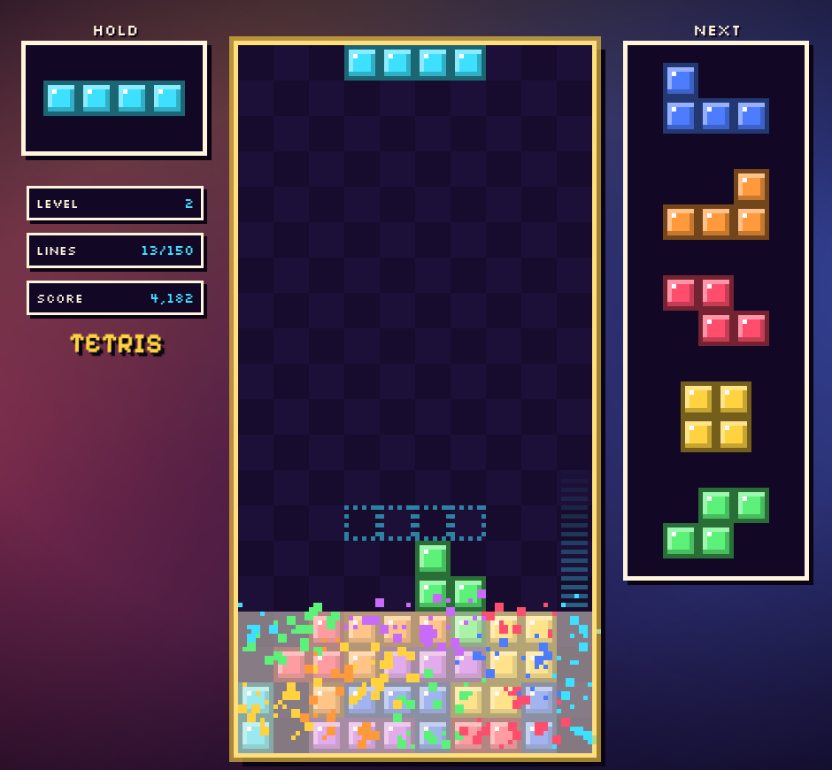
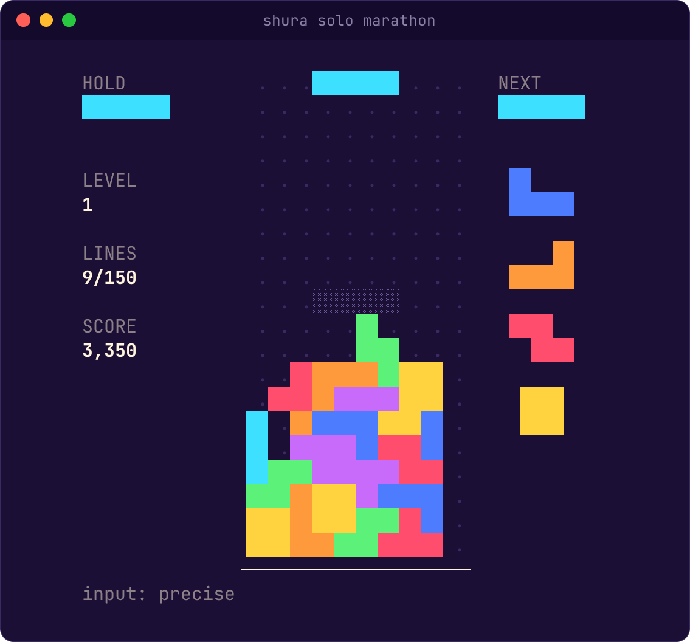
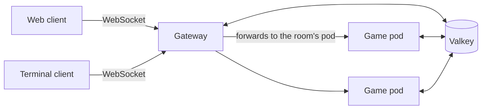

<div align="center">

# Shura

_Online multiplayer falling-block battles, in your browser or your terminal._

[](LICENSE)
[](https://nodejs.org)
[](https://www.typescriptlang.org)
[](#roadmap)

[Features](#features) • [Getting started](#getting-started) • [Controls](#controls) • [Terminal client](#terminal-client) • [Web client](#web-client) • [How it works](#how-it-works) • [Development](#development)

</div>

**Shura** (Hebrew שורה, "row") is a falling-block puzzle game with modern guideline rules. Clear lines, send garbage at your opponents, and outlast them in 1v1 or free-for-all matches of up to 8 players. The web and terminal clients play in the same rooms, so a friend in the browser can battle you in your terminal.

<table>
  <tr>
    <td width="50%"></td>
    <td width="50%"></td>
  </tr>
  <tr>
    <td align="center">In the browser</td>
    <td align="center">In the terminal</td>
  </tr>
</table>

> [!NOTE]
> Shura is **in development**. Marathon, Sprint and Ultra are playable today in both clients, run from source. Online play arrives in M4, and the `shura` npm package is published in M6. See the [roadmap](#roadmap).

## Features

- **Modern rules**: SRS rotation with 180° kicks, 7-bag, hold, 5-piece preview, ghost piece, T-spins (full and mini), back-to-back, combos and perfect clears.
- **Two clients, one game**: a React + PixiJS web client and an [Ink](https://github.com/vadimdemedes/ink) terminal client share the same engine, settings, themes and skins.
- **Arcade look**: pixel-art cells, three themes (Indigo, Plum, Deep Sea) and three skins (Pixel, Flat, Outline). In the browser, line clears burst into particles, the board shakes, and 8-bit sounds rise in pitch with your combo.
- **Tunable handling**: DAS, ARR and soft-drop speed are client settings, with precise key-release input in terminals that support it. Every key can be rebound.
- **Personal bests**: each mode keeps your best run locally, with its seed and inputs so it can be replayed later.
- **Fair online play** _(M4)_: the server re-simulates every match from the players' inputs, so a modified client can't fake a win.
- **Garbage battles** _(M4)_: attacks cancel incoming garbage first, and margin time ramps up the damage so long matches end.
- **No sign-up** _(M4)_: pick a nickname and play. Share a room code or join the 1v1 quick-match queue.

### Modes

| Mode     | Players | Where   | Goal                                          | Status   |
| -------- | ------- | ------- | --------------------------------------------- | -------- |
| Marathon | 1       | offline | Reach 150 lines as gravity speeds up by level | Playable |
| Sprint   | 1       | offline | Clear 40 lines as fast as possible            | Playable |
| Ultra    | 1       | offline | Score as much as possible in 2 minutes        | Playable |
| 1v1      | 2       | online  | Top out your opponent                         | Planned  |
| FFA      | 3–8     | online  | Be the last player standing                   | Planned  |

Single-player modes run entirely on your machine and never contact a server.

## Getting started

You'll need [Node.js](https://nodejs.org) 26 or newer and corepack for the pinned pnpm (`npm install -g corepack && corepack enable`).

```sh
git clone https://github.com/orkwitzel/shura.git
cd shura
pnpm install
```

**In a terminal**, start the terminal client in its own terminal window:

```sh
pnpm cli               # main menu
pnpm cli solo sprint   # straight into a 40-line sprint
```

**In a browser**, start the dev stack (it also needs Docker, for Valkey) and open http://localhost:5173:

```sh
pnpm dev
```

> [!TIP]
> Once Shura is published, the terminal client will be one command away: `npx shura`, or `npm i -g shura` and then `shura`.

## Controls

| Action               | Web      | Terminal |
| -------------------- | -------- | -------- |
| Move left / right    | ← / →    | ← / →    |
| Soft drop            | ↓        | ↓        |
| Hard drop            | Space    | Space    |
| Rotate clockwise     | ↑, X     | ↑, X     |
| Rotate anticlockwise | Z, Ctrl  | Z        |
| Rotate 180°          | A        | A        |
| Hold                 | C, Shift | C        |
| Menu                 | Esc, P   | Esc, P   |

The in-game menu has its own shortcuts: **Resume** (Esc, Enter), **Restart** (R), **Settings** (S) and **Quit to menu** (Q). Every game control can be rebound in settings. Default handling is DAS 167 ms, ARR 33 ms and a ×20 soft-drop factor.

## Terminal client

```text
shura                          main menu
shura solo sprint|marathon|ultra
shura quick                    join the 1v1 quick-match queue      (M4)
shura create [--mode ffa]      create a room; prints its code      (M4)
shura join <CODE>              join a room                         (M4)

--input precise|basic          override input detection
--no-color                     draw cells as glyphs instead of colors
--server <url>                 game server to connect to           (M4)
--name <nickname>              nickname for this session           (M4)
```

From source, pass the same arguments to `pnpm cli`. The terminal needs to be at least 80×24.

Settings live in `~/.config/shura/config.json` (`%APPDATA%\shura` on Windows) and personal bests in `~/.local/share/shura/records.json` (`%LOCALAPPDATA%\shura`). `NO_COLOR` disables color.

> [!TIP]
> For the best feel, use a terminal that reports key releases: kitty, foot, Alacritty, Ghostty, iTerm2, Windows Terminal or WezTerm (with `enable_kitty_keyboard = true`). Shura then uses **precise** input with your exact DAS and ARR. Other terminals, and anything inside tmux, fall back to **basic** input, which follows your OS key-repeat rate.

## Web client

The web client targets desktop browsers with a keyboard (current Chrome, Edge, Firefox and Safari). Its settings screen adds a volume slider and an **Effects** setting (_Full_, _Reduced_ or _Off_), which follows your system's reduced-motion preference until you choose. Settings and personal bests are kept in `localStorage`.

> [!NOTE]
> Sound starts on your first key press in a game, as browsers require.

## How it works



- A deterministic engine runs at 60 frames per second using integer math and seeded randomness, so the same inputs always produce the same game, in Node and in every browser. A replay-hash test suite guards it.
- Clients play optimistically and stream their inputs to the server. The game pod re-runs every player's engine and alone decides who wins.
- Each room lives on one game pod. Gateways are stateless and forward each connection to the pod that owns its room.
- Valkey holds the room registry, quick-match queue, sessions, pod health and a full input log of every running match.

The engine and both clients exist today; the online backend is built in M4 and M5. The details, and the reasoning behind each choice, are in the [design document](docs/design.md) and the [architecture decision records](docs/adr/).

## Development

Besides Node.js 26 and pnpm, `pnpm dev` needs Docker for the local Valkey.

```sh
pnpm dev      # Valkey + gateway + game server + web client on http://localhost:5173
pnpm cli      # terminal client (run it in its own terminal)
pnpm check    # lint, typecheck and tests, the same as CI
```

The repository is a pnpm + Turborepo monorepo:

```text
apps/
  web/          React + PixiJS client
  cli/          Ink terminal client, published to npm as `shura`
  gateway/      public WebSocket and HTTP API, forwards to game pods
  game/         hosts rooms and verifies every match
packages/
  engine/       deterministic game rules
  protocol/     message schemas and version constants
  client-core/  game loop, input, settings and records shared by both clients
  valkey/       registry, queue, session and match-log stores
docs/           design document, ADRs and glossary
```

> [!IMPORTANT]
> The engine must stay deterministic: no `Math.random`, clocks, timers or floats in game rules. A change that alters game outcomes bumps `ENGINE_VERSION`. See [`AGENTS.md`](AGENTS.md) and [design §5](docs/design.md#5-engine).

Branch names, PR titles and the release process are described in [`CONTRIBUTING.md`](CONTRIBUTING.md). Project vocabulary is defined in the [glossary](docs/glossary.md).

### Roadmap

| Milestone | Scope                                          | Status  |
| --------- | ---------------------------------------------- | ------- |
| M0        | Repository skeleton, tooling and CI            | Done    |
| M1        | Game engine with replay-hash tests             | Done    |
| M2        | Terminal client, single-player                 | Done    |
| M3        | Web client, single-player                      | Done    |
| M4        | Online multiplayer                             | Next    |
| M5        | Multiple game pods, health and metrics         | Planned |
| M6        | First release on npm                           | Planned |
