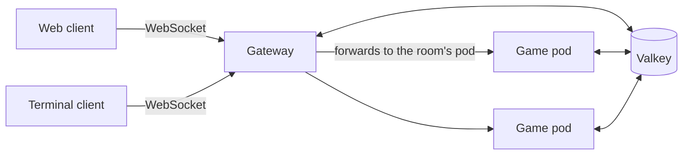

<div align="center">

# Shura

_Online multiplayer falling-block battles, in your browser or your terminal._

[](LICENSE)
[](https://nodejs.org)
[](https://www.typescriptlang.org)
[](docs/design.md#17-roadmap-v1)

[Features](#features) • [Play](#play) • [Controls](#controls) • [Terminal client](#terminal-client) • [How it works](#how-it-works) • [Development](#development)

</div>

**Shura** (Hebrew שורה, "row") is a falling-block puzzle game with modern guideline rules. Clear lines, send garbage at your opponents, and outlast them in 1v1 or free-for-all matches of up to 8 players. The web and terminal clients play in the same rooms, so a friend in the browser can battle you in your terminal.

> [!NOTE]
> Shura is **in design**: nothing is playable yet. The commands below describe the planned release. The full plan is in [`docs/design.md`](docs/design.md) and progress follows the [roadmap](#roadmap).

## Features

- **Modern rules**: SRS rotation with 180° kicks, 7-bag, hold, 5-piece preview, ghost piece, T-spins, back-to-back, combos and perfect clears.
- **Garbage battles**: attacks cancel incoming garbage first, and margin time ramps up the damage so long matches end.
- **Fair online play**: every match is re-simulated by the server from your inputs, so outcomes can't be faked by a modified client.
- **Two clients, one game**: a React + PixiJS web client and an [Ink](https://github.com/vadimdemedes/ink) terminal client share the same engine and connect to the same servers.
- **No sign-up**: pick a nickname and play. Share a 4-character room code or join the 1v1 quick-match queue.
- **Tunable handling**: DAS, ARR and soft-drop speed are client settings, with precise key-release input in terminals that support it.
- **Built to scale**: stateless gateways, game servers that each host many rooms, and Valkey for coordination.

### Modes

| Mode     | Players | Where   | Goal                                  |
| -------- | ------- | ------- | ------------------------------------- |
| Marathon | 1       | offline | Survive as gravity speeds up by level |
| Sprint   | 1       | offline | Clear 40 lines as fast as possible    |
| Ultra    | 1       | offline | Score as much as possible in 2 minutes |
| 1v1      | 2       | online  | Top out your opponent                 |
| FFA      | 3–8     | online  | Be the last player standing           |

Single-player modes run entirely on your machine and keep personal bests locally.

## Play

In a terminal, with [Node.js](https://nodejs.org) 26 or newer:

```sh
npx shura              # interactive menu
npx shura quick        # find a 1v1 opponent
npx shura create       # create a room and get a code to share
npx shura join K7QX    # join a friend's room
npx shura solo sprint  # offline 40-line sprint
```

Or install it globally with `npm i -g shura` and run `shura`.

In a browser, open the Shura website (address to be announced before release).

## Controls

| Action                | Web       | Terminal |
| --------------------- | --------- | -------- |
| Move left / right     | ← / →     | ← / →    |
| Soft drop             | ↓         | ↓        |
| Hard drop             | Space     | Space    |
| Rotate clockwise      | ↑, X      | ↑, X     |
| Rotate anticlockwise  | Z, Ctrl   | Z        |
| Rotate 180°           | A         | A        |
| Hold                  | C, Shift  | C        |
| Pause (single-player) | Esc, P    | Esc, P   |
| Restart (Sprint, Ultra) | R       | R        |

All bindings can be changed in settings. Default handling is DAS 167 ms, ARR 33 ms and a ×20 soft-drop factor.

## Terminal client

```text
shura                          interactive menu
shura quick                    join the 1v1 quick-match queue
shura create [--mode ffa]      create a room; prints its code and link
shura join <CODE>              join a room
shura solo sprint|marathon|ultra

--server <url>                 game server to connect to
--name <nickname>              nickname for this session
--input precise|basic          override input detection
--no-color                     draw cells as glyphs instead of colors
```

The terminal needs to be at least 80×24. On a ~120×30 terminal, up to 7 opponent boards fit beside yours.

Settings live in `~/.config/shura/config.json` (`%APPDATA%\shura` on Windows). `SHURA_SERVER` sets the server, `NO_COLOR` disables color, and `SHURA_NO_UPDATE_CHECK=1` turns off the daily update check.

> [!TIP]
> For the best feel, use a terminal that reports key releases: kitty, foot, Alacritty, Ghostty, iTerm2, Windows Terminal or WezTerm (with `enable_kitty_keyboard = true`). Shura then uses **precise** input with your exact DAS and ARR. Other terminals, and anything inside tmux, fall back to **basic** input, which follows your OS key-repeat rate. The status line shows which one is active.

## How it works



- A deterministic engine runs at 60 frames per second using integer math and seeded randomness, so the same inputs always produce the same game, in Node and in every browser.
- Clients play optimistically and stream their inputs to the server. The game pod re-runs every player's engine and alone decides who wins.
- Each room lives on one game pod. Gateways are stateless and forward each connection to the pod that owns its room.
- Valkey holds the room registry, quick-match queue, sessions, pod health and a full input log of every running match.

The details, and the reasoning behind each choice, are in the [design document](docs/design.md) and the [architecture decision records](docs/adr/).

## Development

> [!IMPORTANT]
> Only the M0 skeleton exists so far: the services answer health checks and the clients are placeholders.

You'll need Node.js 26, Docker for the local Valkey, and corepack for the pinned pnpm (`npm install -g corepack && corepack enable`).

```sh
pnpm install
pnpm dev      # Valkey + gateway + game server + web client on http://localhost:5173
pnpm cli      # terminal client against your local server (run it in its own terminal)
pnpm check    # lint, typecheck and tests, the same as CI
```

The repository is a pnpm + Turborepo monorepo:

```text
apps/
  web/          React + Vite client
  cli/          Ink terminal client, published to npm as `shura`
  gateway/      public WebSocket and HTTP API, forwards to game pods
  game/         hosts rooms and verifies every match
packages/
  engine/       deterministic game rules
  protocol/     message schemas and version constants
  client-core/  logic shared by both clients
  valkey/       registry, queue, session and match-log stores
docs/           design document, ADRs and glossary
```

Branch names, PR titles and the release process are described in [`CONTRIBUTING.md`](CONTRIBUTING.md). Project vocabulary is defined in the [glossary](docs/glossary.md).

### Roadmap

| Milestone | Scope |
| --------- | ----- |
| M0 | Repository skeleton, tooling and CI |
| M1 | Game engine with replay-hash tests |
| M2 | Terminal client, single-player |
| M3 | Web client, single-player |
| M4 | Online multiplayer |
| M5 | Multiple game pods, health and metrics |
| M6 | First release on npm |
